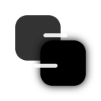
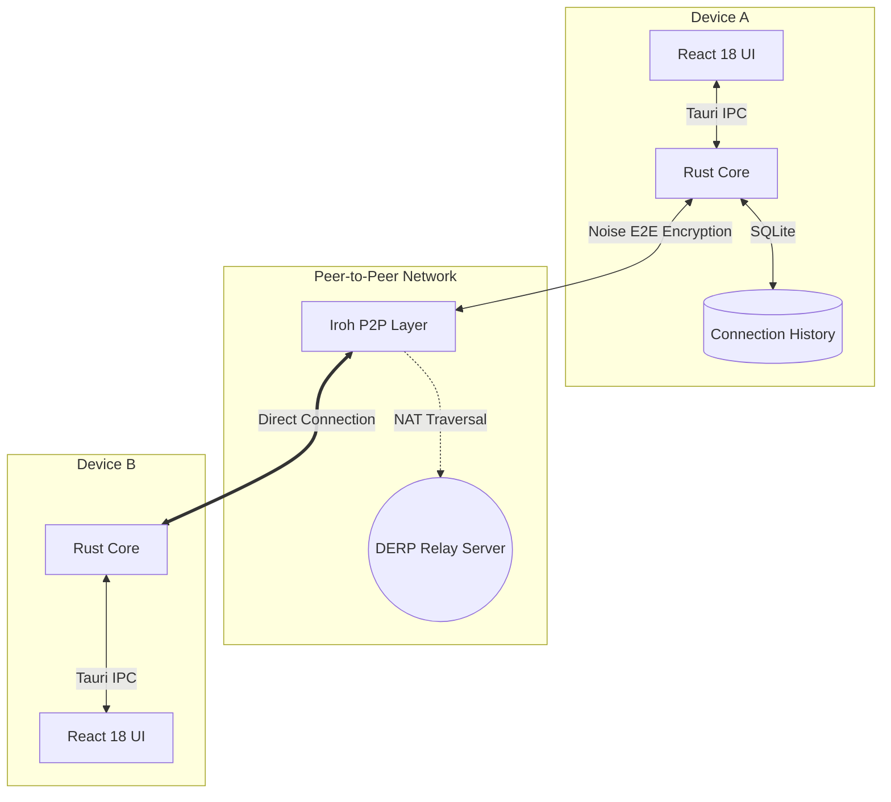

<div align="center">
  

  # Send2Me

  **Fast, 100% Private, Direct File Transfer & Sync Between Devices — Zero Cloud Required.**

  [](#)
  [](LICENSE)
  [](https://tauri.app/)

  <br/>

  <p><b>Built Locally · 100% Offline · Zero External Server Dependencies</b></p>
</div>

<br/>

---

## ⚡ Local Build & Run (3 Easy Steps)

| 1️⃣ Install Dependencies | 2️⃣ Build Locally | 3️⃣ Start Sharing |
| :---: | :---: | :---: |
| `cd apps/desktop && npm install` | `npm run tauri build` or `npm run tauri dev` | Direct peer-to-peer file sharing and folder sync! |

---

## 💻 Local Building

To build the standalone installer or executable on your machine:

```bash
# Navigate to the desktop app directory
cd apps/desktop

# Install node dependencies
npm install

# Build the native production application
npm run tauri build
```

Binary outputs will be located in `apps/desktop/src-tauri/target/release/bundle/`.

---

## ✨ Why Choose Send2Me?

- 🚀 **Unlimited Speed:** Transfers files at your local Wi-Fi router's max speed (100MB/s+).
- 🔒 **100% Private & Encrypted:** Data transfers directly from device A to device B — never touches any cloud server.
- 📂 **Automatic Folder Sync:** Keep a designated folder synchronized across two computers automatically.
- 🎯 **No Account Required:** Zero sign-up, no monthly subscriptions, and no file size limits.

---

<details>
<summary><b>🛠️ Developer & Enterprise Technical Documentation (Click to Expand)</b></summary>

<br/>

### 📖 The Origin & Architecture

Send2Me is built using a deeply optimized **Rust** backend and a **React 18** frontend powered by **Tauri v2**. Network traversal is managed via **Iroh** P2P with Noise end-to-end encryption.



### 🛡️ Enterprise Security & Vulnerability Audits
- [Enterprise Security Policy & Vulnerability Disclosure](SECURITY.md)
- [STRIDE Threat Model Assessment](docs/ThreatModel.md)

### 🔒 Cryptographic Verification
To verify the SHA-256 integrity of release packages:
- **Windows PowerShell:** `Get-FileHash -Algorithm SHA256 .\Send2Me_x64-setup.exe`
- **Linux / macOS:** `sha256sum Send2Me_Linux-x86_64.AppImage`

### 💻 Local Development Setup

```bash
# Clone the repository
git clone https://github.com/AspiringWebGaurav/send2me-rust-app.git
cd send2me-rust-app

# Install frontend dependencies
cd apps/desktop
npm install

# Run application in desktop development mode (from root or apps/desktop)
npm run dev
```

### 📦 Production Build
```bash
npm run build
```
Binaries will be generated in `apps/desktop/src-tauri/target/release/bundle/`.

</details>

---

<div align="center">
  <i>Licensed under MIT. Open Source, Private, & Local Data Ownership.</i>
</div>

